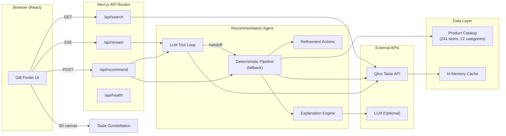
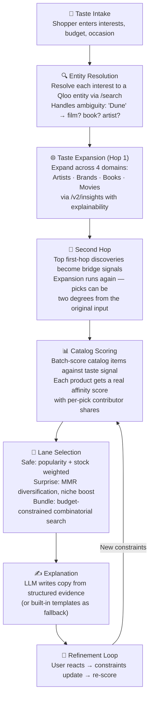
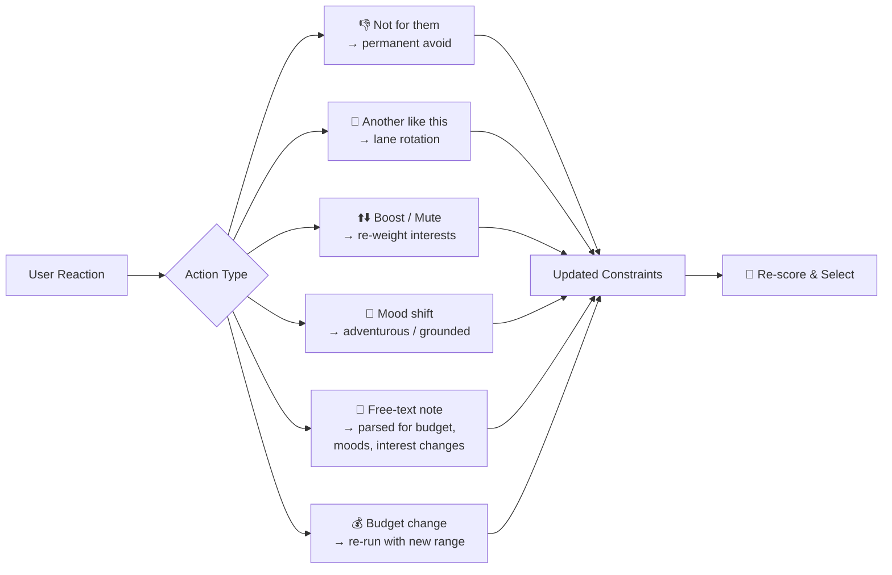

<p align="center">
  
  
  
  
</p>

# 🎁 Tasteprint — Autonomous Gift Discovery Agent

> *"A deterministic pipeline is not an agent. An agent reasons, plans, uses tools, handles surprises, and adapts to the shopper."*  
> **Built for the Qloo Agentic Hackathon.**

Tasteprint is an autonomous AI gift agent that discovers thoughtful, unexpected gifts by navigating a person's **cultural taste graph**. Instead of rigid keyword matching, an LLM agent uses [Qloo](https://qloo.com)'s cultural intelligence API as discrete tools to reason across music, film, TV, books, and brands — matching recipient taste to real products in a curated catalog.

Every search delivers **three distinct angles** on the same person:

| Lane | What it does |
|------|-------------|
| 🟢 **The Sure Thing** | The gift with the strongest affinity to what they already love |
| 🩷 **The Unexpected** | A cross-domain discovery from Qloo's graph they'd never find themselves |
| 🟡 **Better Together** | A multi-item set that tells one taste story across categories, within budget |

---

## 🧠 What Makes Tasteprint an Agent (Not a Pipeline)

Most hackathon projects wrap an API in a fixed sequence: `resolve → expand → score → select`. Tasteprint is fundamentally different:

1. **Autonomous Tool-Calling Loop (`agent.ts`):**  
   The LLM drives the hunt in an open loop up to 14 bounded steps, calling discrete tools:
   - `resolve_entity`: Disambiguates free-text interests across 700M+ entities (e.g. film vs book).
   - `expand_taste`: Explores multi-domain neighbors; decides whether hop-1 affinity density justifies a second-hop bridge.
   - `score_candidates`: Computes statistical affinity vectors between recipient taste graph and real catalog products.
   - `check_budget`: Price-checks proposed combinations against the shopper's budget ceiling before committing.
   - `select_lanes`: Commits the final Safe Bet, Wild Card, and Bundle.
2. **Re-planning on Constraint Violations:**  
   If a proposed bundle blows the budget, the agent receives the error, re-evaluates the candidate pool, and re-plans with cheaper items or a 2-item bundle.
3. **Live 3D Taste Constellation (`TasteConstellation.tsx`):**  
    Rather than rendering a flat list, Tasteprint renders a three.js "taste constellation" as discoveries stream in over SSE — orbitable in 3D (mouse or keyboard), with real affinity percentages, `via` attribution chains, node coloring by domain, and a reduced-motion pause. A WebGL-free SVG diagram plus a list view guarantee the graph degrades gracefully on any device.
4. **Fail-Safe Fallback Pipeline (`pipeline.ts`):**  
   If no LLM key is configured, rate limits fire, or the agent loop exhausts its steps, the system transparently falls back to our deterministic pipeline so the demo never dies on stage.
5. **Adversarial Invariant Eval Harness (`npm run eval`):**  
   10 fixed adversarial recipient profiles tested against catalog authenticity, per-lane budget compliance, category divergence (wild card $\neq$ safe category), and zero cross-lane duplication.
6. **Hardened Demo Replay Mode (`TASTEPRINT_REPLAY=1`):**  
   Instant offline playback from recorded golden fixtures (`demo-scenarios.json`) ensuring stage demonstrations never hang under network or rate-limiting delays. The two sample profiles (Priya, Devon) play back with realistic pacing from the UI, and any replay can be handed off to a live retry in one click. Re-record fixtures after catalog changes with `npm run demo:record`.

---

## ✨ Key Features

- **LLM Tool Loop** — autonomous reasoning over Qloo tools with real-time SSE progress events
- **Interactive 3D Taste Constellation** — three.js visualization of two-hop cultural connections, with SVG/list fallbacks for reduced motion and no WebGL
- **Culturally Broad Catalog** — 241 real products across 22 categories, spanning Afrobeats to Ethio-jazz, Nigerian literature to Korean cinema, Kyoto matcha to Malian mud cloth
- **Deep-Black Editorial Design** — self-hosted Manrope, film-poster typography, responsive down to 375 px, `prefers-reduced-motion` aware
- **Sample Profile Playback** — recorded "golden" searches (Priya, Devon) demo the full agent experience offline, plus a replay-first live retry
- **Saved Gifts Shortlist** — heart any pick into a persistent local shortlist with a copy-to-clipboard summary
- **Voice Refinement** — Web Speech API integration to refine gifts using your natural shopper voice
- **Real Product Links** — direct product pages and honest store labeling (`Find on Amazon ↗`, `Shop A24 ↗`, `Shop Criterion ↗`)
- **Automated Invariant Eval** — `npm run eval` gates quality across 10 adversarial profiles
- **Stateless Client Architecture** — refinement state and taste profiles persist in the sharable URL
- **Fail-Safe Fast Path** — seamless fallback to deterministic pipeline if LLM is unavailable

## 🏗️ Architecture



---

## 🔄 How It Works — The Recommendation Pipeline



### Pipeline Stages in Detail

| Stage | Qloo API | What happens |
|-------|----------|-------------|
| **Entity Resolution** | `GET /search` | Each interest → Qloo entity ID. Ambiguous names show alternatives with "did you mean?" |
| **Taste Expansion** | `GET /v2/insights` | Resolved entities used as `signal.interests.entities` across 4 discovery domains. `feature.explainability=true` enables contributor tracking |
| **Second Hop** | `GET /v2/insights` | Top first-hop discoveries added to signal mix → expansion runs again. "Via" chains retained for explanation |
| **Catalog Scoring** | `GET /v2/insights` | Candidate entity IDs batch-scored with `filter.results.entities` so each product gets a real affinity score |
| **Lane Selection** | — | Safe lane: popularity + stock tilt. Wild card: MMR diversification against safe pick (niche affinity boosted). Bundle: budget-truncated search with category/type/brand diversity bonuses. Optional category filter (`categories`) constrains the pool to chosen product categories |
| **Explanation** | — | LLM (optional) writes copy from structured evidence. Without an LLM key, built-in templates are used |

---

## 🔁 Refinement Loop

Every pick can be reacted to — the agent re-scores with updated constraints while the server stays fully stateless:



---

## 🛠️ Tech Stack

| Layer | Technology |
|-------|-----------|
| **Framework** | [Next.js 16](https://nextjs.org) (App Router) |
| **Language** | TypeScript 5 |
| **UI** | React 19 + Tailwind CSS 4 |
| **3D Graph** | three.js + OrbitControls (SVG fallback) |
| **Taste Intelligence** | [Qloo API](https://qloo.com) (`hackathon.api.qloo.com`) |
| **Explanation Copy** | Any OpenAI-compatible LLM (optional) |
| **Deployment** | Vercel / any Node.js host |

---

## 🚀 Getting Started

### Prerequisites

- **Node.js** 18+ 
- **Qloo API Key** — get one from the [Qloo Developer Guide](https://docs.qloo.com/reference/qloo-llm-hackathon-developer-guide#getting-your-api-key)

### Installation

```bash
# Clone the repository
git clone https://github.com/Sajibv1/tasteprint.git
cd tasteprint

# Install dependencies
npm install

# Set up environment variables
cp .env.example .env.local
# Edit .env.local and add your QLOO_API_KEY

# Start the development server
npm run dev
```

Open [http://localhost:3000](http://localhost:3000) 🎉

### Verify Qloo Connectivity

```bash
curl http://localhost:3000/api/health
```

A successful response confirms the API key is valid and the Qloo API is reachable.

### Environment Variables

| Variable | Required | Default | Description |
|----------|----------|---------|-------------|
| `QLOO_API_KEY` | ✅ Yes | — | Hackathon API key from the [Qloo Developer Guide](https://docs.qloo.com/reference/qloo-llm-hackathon-developer-guide#getting-your-api-key) |
| `QLOO_BASE_URL` | No | `https://hackathon.api.qloo.com` | Qloo API base URL |
| `LLM_API_KEY` | No | — | Any OpenAI-compatible key for richer explanation copy |
| `LLM_BASE_URL` | No | `https://api.openai.com/v1` | LLM endpoint (works with Groq, Together, etc.) |
| `LLM_MODEL` | No | `gpt-4o-mini` | Model to use for explanations |

---

## 📡 API Reference

### `POST /api/recommend`

Synchronous recommendation — returns the full result in one JSON response.

```json
{
  "recipientName": "Maya",
  "interests": ["Radiohead", "Studio Ghibli", "In the Mood for Love"],
  "budget": { "min": 0, "max": 120 },
  "occasion": "Birthday"
}
```

**Response** includes:
- Resolved interests with alternates and candidates
- Discovered taste map (1-hop and 2-hop entries)
- Taste connections (`from → to at X%, via Y`)
- Three gift picks with per-item affinity scores, contributor breakdowns, reasons, and buy links

---

### `POST /api/stream`

The same agent over **Server-Sent Events** — streams real-time progress events.

**Initial recommendation:**

```json
{ "kind": "recommend", "request": { "interests": ["Radiohead"] } }
```

**Refinement (with constraint state from the client):**

```json
{
  "kind": "refine",
  "request": { "interests": ["Radiohead"] },
  "action": { "kind": "note", "text": "under $60, less Radiohead, bolder" },
  "constraints": {
    "avoidItemIds": ["tp-014"],
    "muteInterests": ["Radiohead"],
    "mood": "adventurous"
  }
}
```

**SSE Event Types:**

| Event | Description |
|-------|-------------|
| `stage` | Pipeline stage update (resolve, expand, hop2, score, select, explain) |
| `interest` | An interest resolved to a Qloo entity |
| `expansion` | A taste discovery from the expansion phase |
| `agent-step` | A tool decision made by the LLM agent |
| `warning` | Non-fatal issue (e.g., a domain failed) |
| `agent-note` | Internal agent observation |
| `selection` | Lane selection summary |
| `clarification` | Agent asks the shopper to disambiguate (question + option buttons) |
| `dossier` | Cultural taste dossier (title, narrative, keywords) for the results header |
| `result` | Final payload with picks + shelf + merged constraints |

**Refinement Actions:**

| Action | Description |
|--------|-------------|
| `budget` | Set `newMin` / `newMax` |
| `avoid` | Permanently exclude items by ID |
| `more` | Rotate a lane's pick (keep exploring) |
| `reset-picks` | Clear prior-item memory |
| `mood` | `adventurous` · `grounded` · `clear` |
| `boost` | Boost / mute / clear an interest's weight |
| `note` | Free text — auto-parsed for budget, moods, interest changes |

---

### `GET /api/search?q=radiohead`

Entity search endpoint — returns Qloo entities matching the query with name, type, and popularity. Used by the interest picker in the UI for typeahead disambiguation.

---

### `GET /api/health`

Returns Qloo API connectivity status and key validity.

---

### `GET /api/eval`

Runs fixed recipient profiles through the recommendation engine and checks catalog, budget, category, duplication, and evidence invariants. Add `?engine=pipeline` to force the deterministic engine or `?only=ghibli-birthday` to run one profile.

```bash
npm run eval
npm run eval -- --engine=pipeline
```

---

## 🗂️ Project Structure

```
tasteprint/
├── src/
│   ├── app/
│   │   ├── page.tsx              # Server component: catalog + section data
│   │   ├── layout.tsx            # Root layout (self-hosted Manrope)
│   │   ├── globals.css           # Deep-black editorial design system
│   │   ├── fonts/                # Manrope variable font + OFL license
│   │   └── api/
│   │       ├── health/route.ts   # Health check endpoint
│   │       ├── recommend/route.ts # Sync recommendation endpoint
│   │       ├── stream/route.ts   # SSE streaming endpoint (agent + replay)
│   │       ├── eval/route.ts     # Recommendation eval endpoint
│   │       └── search/route.ts   # Entity search for typeahead
│   ├── components/
│   │   ├── TasteprintApp.tsx     # Client app shell: intake, SSE, results
│   │   ├── TasteConstellation.tsx# three.js taste graph (orbit/keyboard)
│   │   ├── TasteGraph.tsx        # Graph wrapper: 3D / list toggle + inspector
│   │   ├── ConstellationFallback.tsx # SVG diagram when WebGL is unavailable
│   │   ├── Hero.tsx              # Landing hero with live constellation
│   │   ├── Collection.tsx        # Browsable collection preview
│   │   ├── HowItWorks.tsx        # Pipeline explainer section
│   │   ├── GiftShelf.tsx         # Ranked discovery shelf (filter/sort/search)
│   │   ├── GiftCard.tsx          # Gift card: media, affinity, save, avoid
│   │   ├── SavedGifts.tsx        # localStorage shortlist + dialog + toast
│   │   ├── AgentActivity.tsx     # Live agent progress feed (cancelable)
│   │   ├── LaneCard.tsx          # Safe / Unexpected / Bundle lane cards
│   │   ├── VoiceNoteInput.tsx    # Web Speech API refinement input
│   │   └── …                     # Icon, ProductImage, ContributorBar, …
│   ├── lib/
│   │   ├── agent/
│   │   │   ├── agent.ts          # LLM-directed Qloo tool loop
│   │   │   ├── pipeline.ts       # Deterministic recommendation pipeline
│   │   │   ├── tools.ts          # Guarded agent tool implementations
│   │   │   ├── discovery.ts      # Category/entity-diverse ranking
│   │   │   ├── replay.ts         # Recorded golden-run playback
│   │   │   ├── eval-profiles.ts  # Adversarial eval profiles
│   │   │   ├── invariants.ts     # Engine-independent result checks
│   │   │   ├── types.ts          # TypeScript types for the agent
│   │   │   ├── actions.ts        # Refinement action handlers + note parser
│   │   │   ├── explain.ts        # LLM / template explanation generator
│   │   │   └── llm-note.ts       # LLM-driven note interpretation
│   │   ├── agent-stream.ts       # SSE reader (chunk/CRLF-safe) + replay pacing
│   │   ├── taste-graph.ts        # Constellation layout + hero graph data
│   │   ├── gift-media.ts         # Product vs. cultural imagery selection
│   │   ├── demo-profiles.ts      # Recorded sample profiles (Priya, Devon)
│   │   ├── qloo/
│   │   │   ├── client.ts         # Qloo API client (retry, rate-limit, cache)
│   │   │   └── types.ts          # Qloo API type definitions
│   │   └── catalog.ts            # Catalog loader (base + curated rows)
│   ├── data/
│   │   ├── catalog.json          # 161 products, each mapped to a Qloo entity
│   │   ├── curated-gifts.ts      # 80 additional formats on verified entities
│   │   ├── catalog-entities.json # Pre-resolved Qloo entity IDs (checked in)
│   │   └── demo-scenarios.json   # Recorded golden runs for offline replay
│   └── instrumentation.ts        # Server startup (catalog warm-up)
├── scripts/
│   ├── resolve-catalog.mjs       # Qloo entity resolution (merges, checked in)
│   ├── eval.mjs                  # Invariant eval runner
│   └── record-scenarios.mjs      # Re-record demo replay fixtures
├── docs/                         # DESIGN.md, DEMO_SCRIPT.md
├── .env.example
├── package.json
├── tsconfig.json
└── LICENSE
```

---

## 🛒 Catalog

The catalog is **241 real products across 22 categories** (161 entries in `src/data/catalog.json` plus 80 extra formats in `src/data/curated-gifts.ts`), spanning Western indie classics to rarely-surfaced global culture — the breadth is deliberate, so a Fela Kuti listener gets Fela-adjacent picks rather than a default white-brand gadget:

| Category | Count | Examples |
|----------|-------|---------|
| Reading | 54 | Global fiction and nonfiction (*Things Fall Apart*, *Pachinko*, *Persepolis*), hardcovers, e-reader |
| Vinyl | 41 | Afrobeats, Ethio-jazz, bossa nova, qawwali, city pop, K-pop, flamenco (Fela Kuti, Ravi Shankar, BTS…) |
| Cinema | 25 | World cinema and Criterion editions (*Pather Panchali*, *RRR*, *Squid Game*, *City of God*…) |
| Stationery | 12 | Yūzen washi letter sets, journals, notebooks |
| Gaming | 12 | Switch/PS5 games, controllers, consoles |
| Art Print | 10 | Posters, art prints, collectible postcards |
| Home | 8 | Lamps, candles, décor, Iittala glassware |
| Audio Gear | 7 | Turntables, headphones, speakers |
| Apparel | 7 | Sneakers, fleece, beanies |
| Photography | 7 | Cameras, film |
| Kitchen | 7 | Tagines, cocottes, spice tins, molinillo sets |
| Coffee | 6 | Grinders, brewers, pour-over sets |
| Collectible | 6 | LEGO, figures, Oaxacan alebrijes |
| Beauty | 6 | K-beauty, fragrance, skincare |
| Tea | 6 | Matcha ceremony sets, Moroccan glasses, tea chests |
| Tabletop | 6 | Chess, go, mahjong, dominoes, carrom, lotería |
| Creative Kits | 5 | Craft kits |
| Gift | 4 | Memberships, tasting boxes |
| Instruments | 4 | Kora, oud, ukulele, tabla |
| Textiles | 4 | Malian mud cloth, Anatolian kilim, kente, Marimekko |
| Outdoors | 3 | Drinkware |
| Experiences | 1 | Class voucher |

**Price range:** $9 – $199

Each product maps to a Qloo entity by name and type. Product artwork is the mapped entity's own image from Qloo's graph (album art, posters, covers, brand marks); items without entity artwork render an initial tile instead of a stock photo. Entity IDs are pre-resolved (`npm run catalog:resolve` merges into `src/data/catalog-entities.json`, which is checked in) so a cold start doesn't pay ~240 entity searches; unmapped items fall back to runtime resolution with a server-memory cache. **No bulk Qloo response data is stored in this repository.**

---

## 🚢 Deploying

### Vercel (Recommended)

1. Import the repository on [Vercel](https://vercel.com)
2. Add the environment variables (`QLOO_API_KEY` at minimum)
3. Deploy

### Self-hosted

```bash
npm run build
npm start
```

Works on any Node.js 18+ host.

---

## 📐 Design Decisions

| Decision | Rationale |
|----------|-----------|
| **Stateless server** | All constraint state lives on the client — the server can be horizontally scaled or replaced without session affinity |
| **Two-hop expansion** | A single hop stays too close to stated interests. The second hop through bridge entities surfaces genuinely surprising connections |
| **Three lanes** | Safe / Surprise / Bundle covers the full confidence spectrum — from "can't go wrong" to "I had no idea" |
| **MMR diversification** | The wild-card pick uses Maximal Marginal Relevance against the safe pick to guarantee it feels different |
| **Optional LLM** | The app is fully functional without an LLM key. Templates and regex parsing handle the common cases; the LLM adds polish |
| **SSE streaming** | The pipeline takes 3–8 seconds. Streaming keeps the user engaged with real-time stage updates and discoveries |

---

## 🏆 Built For

**Qloo Agentic Hackathon** — showcasing Qloo's taste intelligence API for cross-domain cultural discovery.

## 📄 License

MIT — see [LICENSE](LICENSE).
