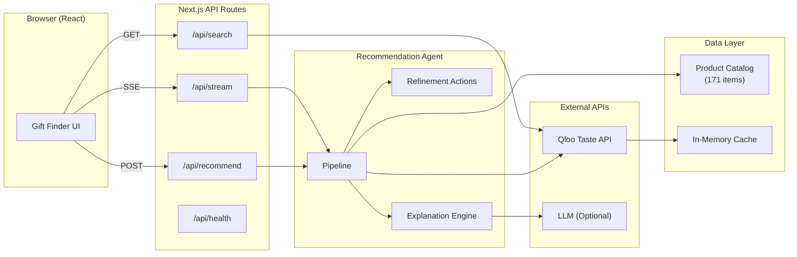
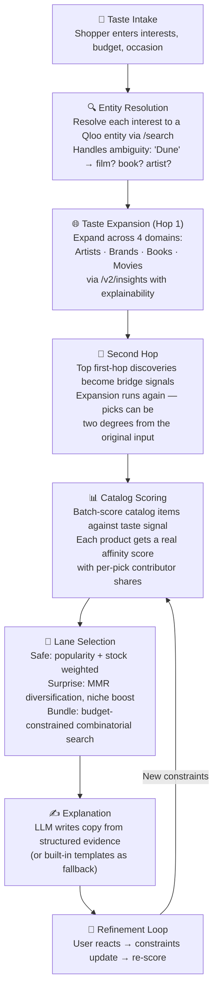
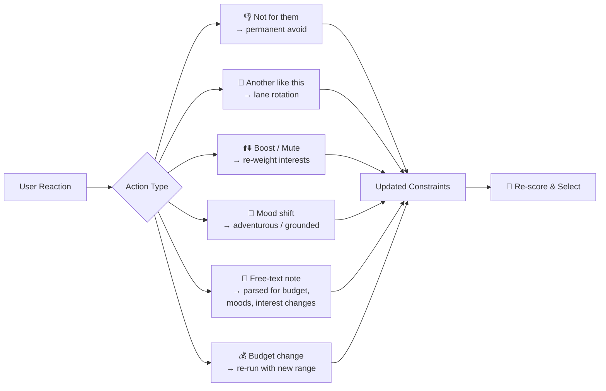

<p align="center">
  
  
  
  
</p>

# 🎁 Tasteprint — AI Gift Discovery Through Cultural Taste

> **Tell us what they love. We'll find what they didn't know they wanted.**

Tasteprint is an AI gift agent that finds thoughtful, unexpected gifts by reading a person's **cultural taste print**. It uses [Qloo](https://qloo.com)'s taste intelligence API to connect interests across music, film, TV, books, and brands — then matches them to real products in a curated catalog.

Every search returns **three angles** on the same person:

| Lane | What it does |
|------|-------------|
| 🟢 **Safe Bet** | The gift with the strongest affinity to what they already love |
| 🩷 **Wild Card** | A cross-domain discovery from Qloo's graph they'd never find themselves |
| 🟡 **The Bundle** | A multi-item set that tells one taste story across categories, within budget |

Each pick comes with a human-readable explanation grounded in the recipient's taste signals — written by an LLM (or built-in templates when no LLM key is set).

---

## ✨ Key Features

- **Taste-graph powered** — goes beyond keyword matching; uses Qloo's cultural knowledge graph spanning 700M+ entities
- **Two-hop discovery** — finds gifts two degrees of separation away from stated interests
- **Three recommendation lanes** — Safe / Surprise / Bundle picks with per-item affinity scores
- **Category filter** — optionally narrow the search to chosen product categories; leave empty to search everything
- **Explainable results** — every pick shows *which* interests drove it, with contributor shares and "via" chains
- **Interactive refinement** — boost/mute interests, adjust budget, change mood, mark items as "not for them", or type free-text notes
- **Stateless server** — all constraint state lives on the client; the server stays stateless and re-runnable
- **SSE streaming** — real-time progress events while the agent thinks (stage updates, discoveries, warnings)
- **Graceful degradation** — works without an LLM key using built-in templates and regex note parsing

---

## 🏗️ Architecture



---

## 🔄 How It Works — The Recommendation Pipeline



### Pipeline Stages in Detail

| Stage | Qloo API | What happens |
|-------|----------|-------------|
| **Entity Resolution** | `GET /search` | Each interest → Qloo entity ID. Ambiguous names show alternatives with "did you mean?" |
| **Taste Expansion** | `GET /v2/insights` | Resolved entities used as `signal.interests.entities` across 4 discovery domains. `feature.explainability=true` enables contributor tracking |
| **Second Hop** | `GET /v2/insights` | Top first-hop discoveries added to signal mix → expansion runs again. "Via" chains retained for explanation |
| **Catalog Scoring** | `GET /v2/insights` | Candidate entity IDs batch-scored with `filter.results.entities` so each product gets a real affinity score |
| **Lane Selection** | — | Safe lane: popularity + stock tilt. Wild card: MMR diversification against safe pick (niche affinity boosted). Bundle: budget-truncated search with category/type/brand diversity bonuses. Optional category filter (`categories`) constrains the pool to chosen product categories |
| **Explanation** | — | LLM (optional) writes copy from structured evidence. Without an LLM key, built-in templates are used |

---

## 🔁 Refinement Loop

Every pick can be reacted to — the agent re-scores with updated constraints while the server stays fully stateless:



---

## 🛠️ Tech Stack

| Layer | Technology |
|-------|-----------|
| **Framework** | [Next.js 16](https://nextjs.org) (App Router) |
| **Language** | TypeScript 5 |
| **UI** | React 19 + Tailwind CSS 4 |
| **Taste Intelligence** | [Qloo API](https://qloo.com) (`hackathon.api.qloo.com`) |
| **Explanation Copy** | Any OpenAI-compatible LLM (optional) |
| **Deployment** | Vercel / any Node.js host |

---

## 🚀 Getting Started

### Prerequisites

- **Node.js** 18+ 
- **Qloo API Key** — get one from the [Qloo Developer Guide](https://docs.qloo.com/reference/qloo-llm-hackathon-developer-guide#getting-your-api-key)

### Installation

```bash
# Clone the repository
git clone https://github.com/your-username/tasteprint.git
cd tasteprint

# Install dependencies
npm install

# Set up environment variables
cp .env.example .env.local
# Edit .env.local and add your QLOO_API_KEY

# Start the development server
npm run dev
```

Open [http://localhost:3000](http://localhost:3000) 🎉

### Verify Qloo Connectivity

```bash
curl http://localhost:3000/api/health
```

A successful response confirms the API key is valid and the Qloo API is reachable.

### Environment Variables

| Variable | Required | Default | Description |
|----------|----------|---------|-------------|
| `QLOO_API_KEY` | ✅ Yes | — | Hackathon API key from the [Qloo Developer Guide](https://docs.qloo.com/reference/qloo-llm-hackathon-developer-guide#getting-your-api-key) |
| `QLOO_BASE_URL` | No | `https://hackathon.api.qloo.com` | Qloo API base URL |
| `LLM_API_KEY` | No | — | Any OpenAI-compatible key for richer explanation copy |
| `LLM_BASE_URL` | No | `https://api.openai.com/v1` | LLM endpoint (works with Groq, Together, etc.) |
| `LLM_MODEL` | No | `gpt-4o-mini` | Model to use for explanations |

---

## 📡 API Reference

### `POST /api/recommend`

Synchronous recommendation — returns the full result in one JSON response.

```json
{
  "recipientName": "Maya",
  "interests": ["Radiohead", "Studio Ghibli", "In the Mood for Love"],
  "budget": { "min": 0, "max": 120 },
  "occasion": "Birthday"
}
```

**Response** includes:
- Resolved interests with alternates and candidates
- Discovered taste map (1-hop and 2-hop entries)
- Taste connections (`from → to at X%, via Y`)
- Three gift picks with per-item affinity scores, contributor breakdowns, reasons, and buy links

---

### `POST /api/stream`

The same agent over **Server-Sent Events** — streams real-time progress events.

**Initial recommendation:**

```json
{ "kind": "recommend", "request": { "interests": ["Radiohead"] } }
```

**Refinement (with constraint state from the client):**

```json
{
  "kind": "refine",
  "request": { "interests": ["Radiohead"] },
  "action": { "kind": "note", "text": "under $60, less Radiohead, bolder" },
  "constraints": {
    "avoidItemIds": ["tp-014"],
    "muteInterests": ["Radiohead"],
    "mood": "adventurous"
  }
}
```

**SSE Event Types:**

| Event | Description |
|-------|-------------|
| `stage` | Pipeline stage update (resolve, expand, hop2, score, select, explain) |
| `interest` | An interest resolved to a Qloo entity |
| `expansion` | A taste discovery from the expansion phase |
| `warning` | Non-fatal issue (e.g., a domain failed) |
| `agent-note` | Internal agent observation |
| `selection` | Lane selection summary |
| `result` | Final payload with picks + merged constraints |

**Refinement Actions:**

| Action | Description |
|--------|-------------|
| `budget` | Set `newMin` / `newMax` |
| `avoid` | Permanently exclude items by ID |
| `more` | Rotate a lane's pick (keep exploring) |
| `reset-picks` | Clear prior-item memory |
| `mood` | `adventurous` · `grounded` · `clear` |
| `boost` | Boost / mute / clear an interest's weight |
| `note` | Free text — auto-parsed for budget, moods, interest changes |

---

### `GET /api/search?q=radiohead`

Entity search endpoint — returns Qloo entities matching the query with name, type, and popularity. Used by the interest picker in the UI for typeahead disambiguation.

---

### `GET /api/health`

Returns Qloo API connectivity status and key validity.

---

## 🗂️ Project Structure

```
tasteprint/
├── src/
│   ├── app/
│   │   ├── page.tsx              # Main gift finder UI (React client component)
│   │   ├── layout.tsx            # Root layout
│   │   └── api/
│   │       ├── health/route.ts   # Health check endpoint
│   │       ├── recommend/route.ts # Sync recommendation endpoint
│   │       ├── stream/route.ts   # SSE streaming endpoint
│   │       └── search/route.ts   # Entity search for typeahead
│   ├── lib/
│   │   ├── agent/
│   │   │   ├── pipeline.ts       # Core recommendation pipeline (~1100 lines)
│   │   │   ├── types.ts          # TypeScript types for the agent
│   │   │   ├── actions.ts        # Refinement action handlers + note parser
│   │   │   ├── explain.ts        # LLM / template explanation generator
│   │   │   └── llm-note.ts       # LLM-driven note interpretation
│   │   ├── qloo/
│   │   │   ├── client.ts         # Qloo API client (retry, rate-limit, cache)
│   │   │   └── types.ts          # Qloo API type definitions
│   │   └── catalog.ts            # Catalog loader
│   ├── data/
│   │   └── catalog.json          # 171 curated products mapped to Qloo entities
│   └── instrumentation.ts       # Server startup (catalog warm-up)
├── .env.example
├── package.json
├── tsconfig.json
└── LICENSE
```

---

## 🛒 Catalog

The demo catalog (`src/data/catalog.json`) contains **171 curated products** across 16 categories:

| Category | Count | Examples |
|----------|-------|---------|
| Music | 44 | Vinyl LPs (Radiohead, Frank Ocean, Björk, Miles Davis, Beyoncé…) |
| Reading | 30 | Books, hardcovers, e-readers |
| Film | 32 | Criterion Collection, 4K UHD, box sets, TV series |
| Art Print | 9 | Posters, art prints |
| Stationery | 5 | Journals, notebooks |
| Gaming | 12 | Switch/PS5 games, controllers, consoles |
| Photography | 4 | Cameras, film |
| Gift | 4 | Memberships, gadgets |
| Apparel | 7 | Sneakers, fleece, beanies |
| Home | 5 | Lamps, candles, décor |
| Coffee | 3 | Grinders, brewers |
| Collectible | 4 | LEGO, figures, plush |
| Music Tech | 7 | Turntables, headphones, speakers |
| Beauty | 3 | Fragrance, skincare |
| Outdoors | 1 | Drinkware |
| Tea | 1 | Tea collections |

**Price range:** $9 – $199

Each product maps to a Qloo entity by name and type. Product artwork is the mapped entity's own image from Qloo's graph (album art, posters, covers, brand marks); items without entity artwork render an initial tile instead of a stock photo. Entity IDs are pre-resolved at build time (`npm run catalog:resolve` writes `src/data/catalog-entities.json`, which is checked in) so a cold start doesn't pay ~170 entity searches; unmapped items fall back to runtime resolution with a server-memory cache. **No bulk Qloo response data is stored in this repository.**

---

## 🚢 Deploying

### Vercel (Recommended)

1. Import the repository on [Vercel](https://vercel.com)
2. Add the environment variables (`QLOO_API_KEY` at minimum)
3. Deploy

### Self-hosted

```bash
npm run build
npm start
```

Works on any Node.js 18+ host.

---

## 📐 Design Decisions

| Decision | Rationale |
|----------|-----------|
| **Stateless server** | All constraint state lives on the client — the server can be horizontally scaled or replaced without session affinity |
| **Two-hop expansion** | A single hop stays too close to stated interests. The second hop through bridge entities surfaces genuinely surprising connections |
| **Three lanes** | Safe / Surprise / Bundle covers the full confidence spectrum — from "can't go wrong" to "I had no idea" |
| **MMR diversification** | The wild-card pick uses Maximal Marginal Relevance against the safe pick to guarantee it feels different |
| **Optional LLM** | The app is fully functional without an LLM key. Templates and regex parsing handle the common cases; the LLM adds polish |
| **SSE streaming** | The pipeline takes 3–8 seconds. Streaming keeps the user engaged with real-time stage updates and discoveries |

---

## 🏆 Built For

**Qloo LLM Hackathon** — showcasing Qloo's taste intelligence API for cross-domain cultural discovery.

## 📄 License

MIT — see [LICENSE](LICENSE).
